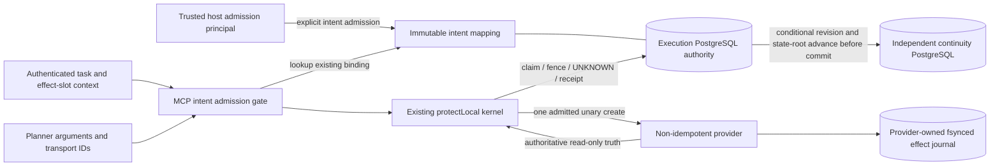

# Silent Chicken: host-owned intent and continuity authority

This candidate closes the measured T06/T07 gaps **in an explicitly configured trusted host profile**. It reuses PR #303's `ExecutionStore` seam and PostgreSQL continuity adapter underneath the existing `protectLocal` kernel; it does not create another dispatcher. Source candidates are SDK 0.1.27 and MCP 0.2.3. Public-current SDK 0.1.25, MCP 0.2.1 and plugin pins remain unchanged until a separate qualified publication. PR #303 and the independent MCP 0.2.2 candidate remain separate review work.

## Identity, admission and trust

`admitPostgresIntent` is a trusted **host admission** operation, not a tool. The host supplies a durable scope and semantic intent key, based on authoritative task/effect-slot data. The registry generates a distinct operation UUID, stores the complete canonical effect fingerprint, and binds it under the pinned execution authority. Re-admission of that same trusted key returns the original binding; changed inputs are CONFLICT. Another intentional action with identical inputs requires another genuinely authorized trusted key. The payload hash is a binding, never the logical identity.

The runtime only calls `createPostgresIntentAuthority(...).resolveIntent(scope,key)`. Missing, damaged or ambiguous intent information denies execution; it cannot initialize a replacement mapping. The MCP host obtains the key from authenticated host context, not tool arguments. A caller operation ID that differs from the admitted ID returns IDENTITY_CONFLICT. Changes to SKU, quantity, destination, provider account, resource or tool conflict before dispatch.

The host pins execution authority ID, generation and epoch, plus independent witness identity. These pins are operator configuration outside the potentially replaced execution history. Runtime SQL roles cannot admit intents, erase history or provision schemas. Admission credentials are not given to the planner or runtime worker. Different pooled connections do not establish independent failure/restore domains: deployment owners must actually provision and authenticate that separation.

## Transaction and crash protocol

Every short authority transaction locks its namespace metadata row, requires PostgreSQL `fsync`, `full_page_writes` and synchronous commit, reads database time and validates pinned schema/generation/epoch. It performs the existing claim/read/update and conditionally advances the independent witness from revision r to r+1, including the old/new full-namespace state digests, **before** committing the matching execution revision and digest. No execution right is returned until acknowledgement completes. Dispatch additionally fences the exact owner/fingerprint/live lease, rechecks expiry after witness admission, and rechecks selectors before the provider callback.

If witness acknowledgement or execution commit is ambiguous, the witness may be ahead. Later access fails closed; CAS is not blindly retried and the adapter never rewinds or recreates either history. This intentionally sacrifices availability. SQL/driver failures do not expose raw credential-bearing causes. Schema scripts are explicit operator provisioning only, with no `IF NOT EXISTS` recovery or startup DDL. The explicit `execution-host-intents-v2.sql` and `continuity-witness-v2.sql` migrations require operator-seeded schema-v2 checkpoints; they do not reinterpret existing SQLite or revision-only history. Scope and intent keys are canonical ASCII identifiers, 1-512 characters from letters, digits, dot, underscore, colon, slash and hyphen.

An abandoned claim expires to UNKNOWN; it never grants a replacement owner permission to dispatch. A crash between reservation and external execution can therefore leave **zero effects and indefinite UNKNOWN**. No guessed CONFIRMED is returned. ABSENT, NOT_FOUND, unavailable lookup, stale, incomplete or mismatched evidence never authorizes redispatch. Exact authoritative positive evidence can durably confirm and replay. Contradictory concurrent confirmations now return CONFLICT to the losing observer and preserve the original durable receipt; the prior test was strengthened accordingly.

## Minimum SQL capabilities

Provision schemas and seed matching authority/witness metadata and initial checkpoints using separate operator credentials. For one execution domain, runtime needs schema USAGE; SELECT and UPDATE(revision,state_digest) on authorities; SELECT/INSERT and UPDATE(state,result_json,owner,lease_until) on operations; SELECT only on host_intents. The admission principal needs authority SELECT/UPDATE(revision,state_digest), intent SELECT/INSERT, and read-only operation access to verify the full namespace state. The witness principal needs schema USAGE, metadata SELECT/UPDATE(schema_version) for row-lock privilege, and checkpoint SELECT/UPDATE(revision,state_digest). Neither runtime nor admission should have DDL, DELETE, TRUNCATE, superuser, role creation, database creation, replication or bypass-RLS authority. Use distinct credentials and per-domain isolation/RLS as appropriate; broad multi-tenant grants are not implied by the fixture.

SQL principals executing the kernel and their host-supplied pools are trusted. This does not protect against arbitrary malicious SQL issued using those trusted credentials. The immutable mapping has no runtime UPDATE/DELETE capability, and all normal changes pass the monotonic witness protocol.

## Migration and compatibility

Legacy SQLite and default MCP helper behavior remain explicit legacy modes. They do not acquire identity admission or cross-restart rollback protection silently. The original baseline T06/T07 counterexamples remain in the suite and still apply to that configuration. Installing only the default MCP package retains its pinned published SDK 0.1.25 dependency. Requesting the new profile on that SDK returns UNSUPPORTED_BOUNDARY before any provider call; it never falls back to SQLite.

The experimental profile requires the exact qualified SDK candidate and MCP candidate in the same dependency graph. The evidence package provides local tarballs and an explicit npm override, retaining separate published-SDK compatibility tests. Any future public packaging change must qualify that pair and update minimum-version guidance before advertising availability. SDK 0.1.27 also includes the previously unmerged shared-authority seam, which needs coordinated review with PR #303; this is not a declaration that PR #303's production gates have cleared.

For a new authorized test domain: provision execution and independently protected witness stores, seed trusted pins/checkpoint, apply the additive intent schema, admit a trusted intent, and only then start runtime workers. For existing real operations: quiesce writers, preserve original receipts/UNKNOWN state and provider identity, obtain authoritative provider evidence, and construct a reviewed complete migration. **No automatic SQLite-to-empty-PostgreSQL migration is supplied.** Losing history does not authorize fresh bootstrap. Recovery never accepts an empty valid-looking ledger as proof that an old action did not happen.

## Evidence and threat boundaries

The historical baseline independently reproduces two effects for T06 and T07. The same maximum-one-effect protection invariant fails RED on that baseline; it is not declared safe because an old test expected the defect. New H01/H02 tests require IDENTITY_CONFLICT / CONTINUITY_LOST and independently one provider effect. A separately admitted identical action remains possible. Other tests cover real process kills before/after effect, repeated replacement workers, concurrent workers, changed bindings, failed/forged provider truth, missing/rewound continuity, unavailable storage, corrupted mappings and SQL privilege denials. Saved artifacts include machine results, event traces, provider journals and durable authority snapshots. Independent checkers import only Node built-ins.

The [actual Summa42 service adapter](../examples/summa42-host-integration/README.md) builds against pinned public revision efc6794ea79a4be5b2f60e376833a1d03cba053c and kills/restarts actual Go service workers. It verifies task/slot identity, unresolved resource exposure and confirmed recovery through the new narrow provider. It does not run the full Box/LLM/planner or gate every unrelated scheduler action. The reference host reconciles before StartAttempt and denies replacement Attempt progression while unresolved; unrelated organizational commitments and the full Box scheduler still need the host-wide integration. Do not claim full #35 closure from a boundary test alone.

Both PostgreSQL clusters in local proof run on one physical machine. Container CI also shares one runner. Independent physical restore domains, verified production TLS, HA, network partitions across real regions, hostile operators, compromised trusted hosts/credentials and coordinated rollback of both stores/configuration are unqualified. Provider truth is trusted only through the reviewed adapter; malicious providers and forged authoritative records outside that trust cannot be solved by a local operation ID. An admitted request cannot be recalled after being issued. Hidden retries inside an opaque provider callback can still create multiple effects; the qualified adapter performs one unary HTTP create, and the existing negative test preserves that limitation.

Namespace-wide locking, full-namespace state verification and witness advancement even on reads create a deliberate coordination/availability cost. The digest scan is O(namespace rows) in work and memory; this small profile does not claim high-throughput scalability. Recorded timings are fixture measurements, not a production SLA, throughput guarantee, cloud price or RTO/RPO. No real payment/order/refund, production credentials, universal exactly-once execution, upstream merger or commercial adoption is claimed. Release and merge remain subject to current-head verification and review; source candidate versions are not publication evidence.

## State-bound v2 and the retained revision-only RED control

A review probe reproduced **two effects under the same operation ID** after deleting operation rows while preserving current revision/metadata on the earlier revision-only candidate. That control and its exact tarballs are retained. Counter equality alone is insufficient for partial-history replacement. The v2 host-intent profile recomputes a canonical SHA-256 commitment over all operation rows and immutable intent mappings inside the locked transaction, verifies the old commitment and conditionally commits the new commitment to the separately authenticated witness before the execution commit. Copying current metadata or locally rehashing empty history does not satisfy the independent witness. H02 exercises both attacks and a coherent rewind before exact recovery.

This is **not** trusting a local checksum or sibling marker: the expected content commitment is independently durable, authenticated, conditionally advanced and pinned to authority/generation/epoch/revision. Bootstrap of a new empty namespace is an explicit operator action; runtime never seeds a missing commitment. Migration of existing revision-only history requires a quiesced, independently verified complete history and trusted operator checkpoint admission. Merely hashing whatever restored ledger happens to exist is not a safe migration. The retained `createPostgresExecutionAuthority` v1 adapter is a draft revision-only compatibility/control surface; it does not qualify for host-intent v2. MCP requires the explicit `once-host-intent-v2` module/capability contract and refuses a downgrade even when candidate version strings happen to match.
